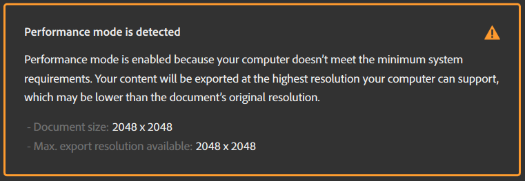

# 하위 사양 모드

하드웨어가 Sampler의 [최소 요구 사항](../getting-started/system-requirements.md)을 충족하지 않는 경우 Sampler은 설정을 변경하는 옵션 없이 [성능 모드](performance-mode.md)와 같은 저사양 모드로 자동으로 실행됩니다.

## 낮은 사양 모드 제한 사항

저사양 모드는 모든 기능을 비활성화하고 최대 미리 보기 해상도가 2048 × 2048인 상태에서 **성능 모드**&#x200B;를 자동으로 켭니다.

낮은 사양 모드는 다음을 비활성화합니다.

* **변위**
* **어두운 영역**
* **경로 추적**

또한 저사양 모드에서는 2048px 이상 2048px× 내보내기가 방지됩니다.

*이 메시지는&#x200B;**낮은 사양 모드**&#x200B;에서 추가 정보를 제공하는 동안&#x200B;**내보내기 창**&#x200B;에 나타납니다.*

## 낮은 사양 모드가 활성화되었는지 확인하는 방법은 무엇입니까?

Sampler을 실행할 때 하드웨어가 최소 요구 사항을 충족하지 않는 경우 충족되지 않는 요구 사항을 나타내는 창이 나타나고 Sampler 실행을 계속할 수 있는 옵션을 제공합니다.

아래 이미지는 VRAM이 8GB 미만인 컴퓨터의 예를 보여줍니다.

**계속 실행**&#x200B;을 선택하면 Sampler은 **낮은 사양 모드**&#x200B;에서 실행됩니다. 위 메시지의 확인란을 사용하여 표시하지 않고 실행한 경우에도 후속 실행 시 다음 배너가 계속 표시됩니다.

마지막으로 **낮은 사양 모드**&#x200B;가 활성화된 상태에서 성능 모드를 끄거나 성능 모드 설정을 조정할 수 없습니다.

